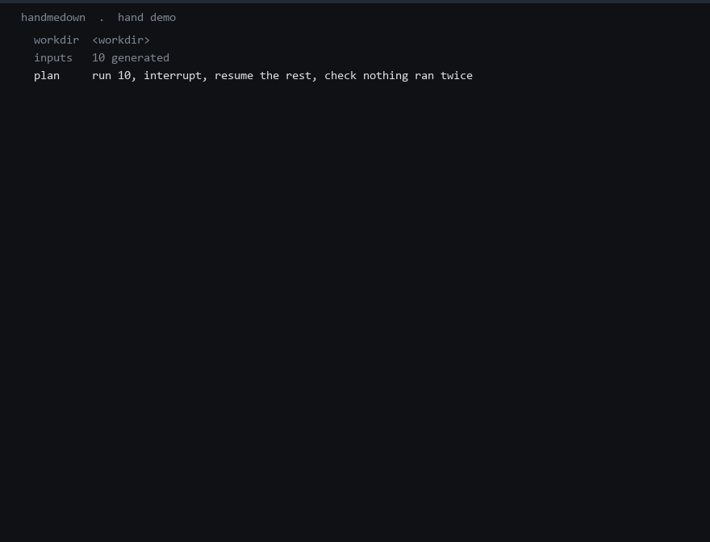
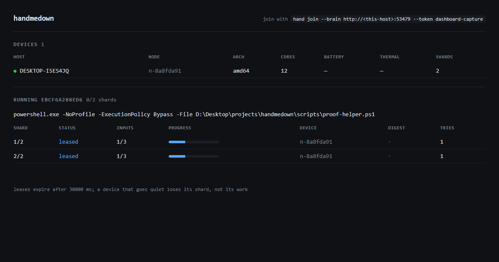

<div align="center">



# handmedown

**Your drawer full of old hardware is a cluster. Prove it in one command.**

A Go agent that runs anywhere — a phone in Termux, a Pi, the laptop you replaced —
and an Elixir brain that is *allowed* to die. Work is checkpointed on the device
that runs it, so a crashed scheduler costs you an attempt, never your results.

[](https://github.com/0DukePan/handmedown/actions/workflows/ci.yml)
[](https://github.com/0DukePan/handmedown/releases/latest)
[](LICENSE)
[](agent)
[](brain)

```sh
curl -fsSL https://raw.githubusercontent.com/0DukePan/handmedown/main/install.sh | sh
```

No account. No containers. No YAML. No inbound ports.

</div>

---

## Why

Everyone has a drawer: an old phone, a Raspberry Pi, the laptop that was replaced twice.
Together they are more compute than most jobs need, and they sit idle because joining them
means Kubernetes, or Nomad, or a shell script full of `ssh` and hope.

`hand` takes the third path. Enrol a device in one command, hand it a list of work, and stop
thinking about it — including about what happens when the device sleeps, throttles, loses
wifi, or has its battery yanked mid-job.

## The demo

The GIF above is not a mock-up. It is `hand demo`, running real work:

```console
$ hand demo

hand demo
  workdir  <workdir>
  inputs   10 generated
  plan     run 10, interrupt, resume the rest, check nothing ran twice

run 1
  [ 1] take-01.txt    ok    136ms
  [ 2] take-02.txt    ok    131ms
  [ 3] take-03.txt    ok    132ms
  [ 4] take-04.txt    ok    131ms
  interrupted after 4 of 10 - kill -9 in production, a cancelled context here

run 2
  [ 1] take-01.txt    skip  (already done, output verified)
  [ 2] take-02.txt    skip  (already done, output verified)
  [ 3] take-03.txt    skip  (already done, output verified)
  [ 4] take-04.txt    skip  (already done, output verified)
  [ 5] take-05.txt    ok    131ms
  ...
  done in 813ms: 6 ran, 4 skipped

verdict
  PASS  10 inputs, 10 outputs, 0 inputs executed twice
  PASS  the 4 finished before the interruption were not repeated
```

`hand demo` exits non-zero if that verdict does not hold. The claim is checked by the command
that makes it, not by the person writing the README.

## The dashboard



Server-rendered HTML over SSE — no JS build, no node_modules, no framework. It shows which
device holds which lease, how far each shard has got, and the digest each shard reported.

## Install

| Platform | |
|---|---|
| **macOS / Linux** | `curl -fsSL https://raw.githubusercontent.com/0DukePan/handmedown/main/install.sh \| sh` |
| **Windows** | `irm https://raw.githubusercontent.com/0DukePan/handmedown/main/install.ps1 \| iex` |
| **Termux (Android)** | the `linux/arm64` build, via the same shell script |

Both installers download the release, verify it against the published `SHA256SUMS.txt`, and
refuse to install on a mismatch. Neither needs root, an administrator, or a reboot.

**Termux** needs `curl` first (`pkg install curl`) — a phone is an ordinary Linux userland on an
arm64 kernel, which is why there is no separate Android artefact.

**Uninstall** is a file and a `PATH` entry: delete `%LOCALAPPDATA%\handmedown` on Windows, or
`~/.local/bin/hand` on macOS and Linux. Nothing else is installed; no service is registered.

### Verify before you run it

The binaries are **unsigned**. There is no purchased certificate and no keyless signing yet, so a
`hand.exe` you download is a `hand.exe` you have to trust or build:

```sh
git clone https://github.com/0DukePan/handmedown && cd handmedown
_bootstrap/env.ps1          # or install Go 1.27 and Elixir 1.20 / OTP 29 yourself
scripts/tasks.ps1 build
```

Every release publishes `SHA256SUMS.txt` and the workflows that produced it are public, so the
checksums are verifiable against CI even though the binaries are not signed.

## Use it

### One machine, today

```sh
hand run --inputs 'samples/*.txt' --outdir out -- ./transcode --in "$HAND_INPUT" --out "$HAND_OUTPUT"
```

Run it once per input, with `HAND_INPUT` / `HAND_OUTPUT` in the environment. Outputs are
content-addressed (`out/1-of-1/take-01.txt.a9a37d340b74`), every input is checkpointed, and the
same command run again skips everything that already finished:

```console
$ hand run --inputs 'samples/*.txt' --outdir out -- ./transcode
job loc-be71930edc0e  shard 1-of-1  5 inputs
resuming: 5 of 5 already finished in a previous run
[1/5] take-01.txt    skip (finished in a previous run)
...
done in 1ms: 0 ran, 5 skipped
```

This needs no brain and no second device. If the distributed half never shipped, this would still
be a resumable, content-addressed task runner.

### A fleet

```sh
# on the machine that will hold the leases (Elixir 1.20 / OTP 29)
cd brain && mix deps.get && mix run --no-halt
# prints the dashboard URL, a join command, and the join token

# on each device
hand join --brain http://192.168.1.20:4100 --token <token>

# from anywhere
hand submit --brain http://192.168.1.20:4100 --token <token> \
  --inputs '*.mov' --shards 4 -- ./transcode --in "$HAND_INPUT" --out "$HAND_OUTPUT"
```

Agents dial **out**, so there is nothing to port-forward and nothing that stops working when a
phone changes network. The brain splits the input list into shards, leases each to a device, and
takes it back if the device goes quiet.

## How it stays correct

The claim, stated narrowly enough to defend:

> A shard survives the death of the brain, the death of the agent, and the disappearance of the
> device. At most one lease interval (30 s) of *attempt* is repeated. Output is never corrupt and
> never duplicated.

| Mechanism | Value | What it buys |
|---|---|---|
| Journal | append-only, `fsync` per record | a crashed agent resumes from its own last committed input |
| Lease TTL | 30 s (heartbeat 5 s, sweep 5 s) | a silent device loses its shard without a quorum or a timeout guess |
| Output | content-addressed, atomic rename | a retry either reproduces the same bytes or lands beside them |
| Completion | deduplicated by digest | two devices reporting different output becomes `conflicted`, never a silent winner |
| Replay | rejects a sequence gap, ignores a torn final line | a half-written journal line is survivable; a missing one is an error |

What that does **not** buy you: exactly-once *execution*. A retried input runs your command again.
If it has side effects, make it idempotent — as with every scheduler ever built. The full
statement, including the limits, is in [docs/DESIGN.md](docs/DESIGN.md).

## What it does not do

- **No containers, no YAML, no scheduler DSL.** A job is a command and a way to split its inputs.
- **No inbound ports and no router changes.** Agents dial out.
- **No exactly-once side effects.** See above.
- **No TLS, and no auth beyond a join token.** Run it on a LAN or over Tailscale. See
  [SECURITY.md](SECURITY.md).
- **No GPU pools, no model sharding, no cloud.**
- **No telemetry.** The binary talks to your brain and nothing else.

## Design

Two languages, because the halves fail in opposite ways:

| | Agent | Brain |
|---|---|---|
| Written in | Go 1.27 | Elixir 1.20 / OTP 29 |
| Ships as | one static binary, <!-- size:agent -->7.10 MB<!-- /size:agent --> | an OTP release, <!-- size:brain -->125.32 MB<!-- /size:brain --> |
| Runs on | a 4 GB phone, a Pi, a laptop | one machine you own |
| Must survive | sleeping, throttling, losing wifi | being `kill -9`ed |
| Recovers by | replaying its own journal | adopting shards from leases in its store |

The agent cannot be BEAM (a release is tens of MB and needs the runtime present — a bad tenant on
a phone that also runs an OS). The brain should not be Go: supervision, per-device processes,
broadcast fan-out and a hot-reloadable control plane are the runtime, not code you write.

[docs/WHY-TWO-LANGUAGES.md](docs/WHY-TWO-LANGUAGES.md) argues this properly, including when *not*
to do it.

The seam between them is deliberately dumb: JSON over one WebSocket, protocol `v1`, agents always
dialling out. Either side could be rewritten without the other noticing, which is the only real
proof that the split is architectural rather than incidental.

## Develop

```powershell
_bootstrap\env.ps1            # Go 1.27, OTP 29, Elixir 1.20 on this shell's PATH (no admin)
scripts\tasks.ps1 check       # gofmt, vet, test, format, compile --warnings-as-errors, test
scripts\tasks.ps1 proof       # hard-kill a local run; assert finished work is never repeated
scripts\tasks.ps1 e2e         # brain + agent + lease + completion + brain crash, real processes
```

Agents and tests, by the numbers: 58 Go test functions, 40 ExUnit tests, and two behavioural
proofs that spawn real processes and kill them ungracefully, because that is the only way to test
a claim about dying.

The documentation is checked too, not just written:

```powershell
scripts\tasks.ps1 test-readme        # every command and link in this README exists
scripts\tasks.ps1 test-workflows     # the release workflow matches the artefact contract
scripts\tasks.ps1 release-test       # build and verify all six artefacts, offline
scripts\tasks.ps1 test-installers    # both installers, against a stubbed release
scripts\tasks.ps1 measure-sizes      # the sizes quoted above, against a real build
scripts\tasks.ps1 demo-gif           # regenerate docs/demo.gif from a real `hand demo`
scripts\tasks.ps1 dashboard-image    # regenerate docs/dashboard.png from a real brain
```

Artefact names, size budgets and the environment variables the installers read live in
[`release-assets.json`](release-assets.json) — one source of truth, read by the rehearsal, the
workflow check, the installers and their tests.

Targets: `linux/amd64`, `linux/arm64`, `linux/arm`, `darwin/arm64`, `darwin/amd64`,
`windows/amd64`.

## Documentation

| | |
|---|---|
| [docs/DESIGN.md](docs/DESIGN.md) | the correctness contract, the lease protocol, and the known gaps |
| [docs/WHY-TWO-LANGUAGES.md](docs/WHY-TWO-LANGUAGES.md) | why the split is load-bearing, and when it would not be |
| [docs/specs/v0.1-shipping.md](docs/specs/v0.1-shipping.md) | the spec this release was built against |
| [SECURITY.md](SECURITY.md) | threat model, what is not protected in v0.1, how to report |
| [CONTRIBUTING.md](CONTRIBUTING.md) | the two rules, the dev loop, what a good test is here |
| [CHANGELOG.md](CHANGELOG.md) | what changed, and the measured sizes behind the argument |

## Status

Working and covered by proofs: the runner, the journal, the scheduler, leases, the dashboard, the
installers and the release rehearsal. Not yet done: TLS on the agent link, a tagged `v0.1.0`
release (the install one-liners start working the moment it is cut), 32-bit macOS, and the
Termux-specific duty-cycle capping. Known gaps are listed in [docs/DESIGN.md](docs/DESIGN.md).

## License

AGPL-3.0. Use it, change it, self-host it. If you run a modified version as a service, share the
changes.
